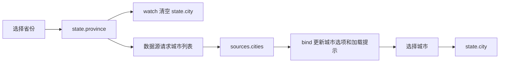

# TODO

## 构建：支持可选 CSS 容器作用域

目标：在构建 CSS 时自动限定 ZUI 样式的生效范围，方便已有 Web 项目逐步接入，减少同名类和全局基础样式对宿主页面的影响。保留现有组件类名、HTML 和 JS 用法。

拟议配置（尚未实现）：

```json
{
    "css": {
        "scope": ".zui-scope"
    }
}
```

实施路径：

- [ ] 在 `scripts/build/config.ts` 的 `BuildOptions`、`BuildPlan` 及配置校验中增加可选的 `css.scope`，默认关闭，未配置时保持现有构建行为。
- [ ] 接入 `scripts/build/css-config.cjs` 的 PostCSS 处理链，在 CSS 导入、Tailwind 展开之后，Autoprefixer 和压缩之前转换选择器，确保覆盖最终产物中的样式并保留 source map。优先评估复用 [postcss-prefix-selector](https://github.com/RadValentin/postcss-prefix-selector)，通过自定义转换补齐 ZUI 规则；避免直接对 CSS 文本做正则替换。
- [ ] 按下表处理普通选择器与特殊规则，避免重复添加作用域前缀。

| 规则 | 转换要求 |
| --- | --- |
| `.btn`、`.menu > li` 等普通选择器 | 添加 `.zui-scope ` 前缀；逗号分隔的选择器分别转换，正确处理 `:is()`、`:not()` 等函数内的选择器列表。 |
| `@media`、`@supports` 等条件规则 | 保留条件，转换内部样式选择器。 |
| `:root`、`html`、`body` 及其组合 | 按语义将主题变量和基础样式映射到容器，避免生成 `.zui-scope :root`、`.zui-scope body` 等无效匹配。 |
| `*`、`::before`、`::after` 等基础规则 | 限定范围，同时覆盖容器自身、后代及其伪元素。 |
| `.dark`、`.light-in-dark`、`.dark-auto` 等主题规则 | 兼顾主题类位于容器自身或内部的情况，明确宿主页面主题的继承策略。 |
| `@keyframes` 及带厂商前缀的动画规则 | 保留动画定义，不给 `from`、`to`、百分比关键帧添加选择器前缀。 |
| `@font-face` | 保留字体定义；字体名与动画名的隔离不属于本次选择器作用域能力。 |

接入边界：

- 作用域只限制 ZUI CSS 的匹配范围，旧项目的全局规则仍可能影响容器内的组件；动画名、字体名仍处于全局命名空间，不宣称双向或完全隔离。
- 动态 Dropdown、Tooltip、Popover、Modal 等浮层须通过各组件的 `container` 选项挂到带相同作用域类的容器；仅包裹触发元素不够。验证定位、裁剪和层叠行为。
- `rem` 仍相对文档 `html` 字号，不能通过设置容器字号改变其基准。明确默认跟随宿主字号，需要固定尺寸时评估现有 `css.remToPx`，不修改宿主 `html`。
- 可搭配按需构建及 `css.preflight: false` 减少影响，但关闭 Tailwind Preflight 不会移除 ZUI 自身的全部全局基础规则。

完成条件：

- [ ] 选择器转换测试覆盖列表、组合选择器、函数伪类、根选择器、容器自身、主题、条件规则、动画及重复处理。
- [ ] 构建产物验证覆盖启用与未启用作用域、压缩与 source map；未启用时保持原有消费契约。
- [ ] 浏览器验证同页容器内外存在同名类时的样式边界，以及按钮、表单和动态浮层在深浅主题、不同宿主根字号下的表现。
- [ ] 补充构建配置和接入文档，说明只加载作用域版 CSS、容器标记、浮层挂载、尺寸策略及隔离限制。

## JSON UI 第二阶段：远程数据源

目标：通过纯 JSON 声明远程数据源，连接第一阶段的状态、数据绑定和组件联动。新增 `dataSources` 配置和只读 `sources` 数据域，沿用 `state → computed → bind/model/when`。以下为拟议方案，尚未实施。

本阶段范围：GET 数据读取、自动加载、手动刷新、请求取消、搜索防抖、加载和错误状态。POST 写操作、响应自动写回 state、数据源之间的自动请求链、跨实例共享缓存和持久化暂不纳入。

### 数据职责与联动

| 数据域 | 用途 | 更新方式 |
| --- | --- | --- |
| `state` | 用户输入、选择、查询条件、页码 | 现有 `model`、`set`、`patchState` |
| `sources.<name>` | 请求结果、加载状态、错误 | 数据源运行时管理，只读 |
| `computed` | 派生展示数据 | 可同时读取 `state` 和 `sources` |



远程响应只更新 `sources`。需要把详情复制到编辑表单时，通过显式 `set` 动作写入 `state`，避免后台响应覆盖用户正在修改的内容。搜索、分页沿用同一模型：输入和页码进入 `state`，作为数据源的查询参数。

### 声明协议

文档继续使用 `version: 1`，新增可选 `dataSources` 字段。没有数据源的现有文档和旧节点协议保持原有行为；使用新增字段需要升级运行时。

| 数据源字段 | 语义与默认值 |
| --- | --- |
| `url` | 必填，字符串或表达式，求值后检查请求地址 |
| `query` | 查询参数映射，每个值单独作为表达式求值 |
| `enabled` | 布尔表达式，默认 `true`；关闭时取消请求并将结果恢复为 `initialData` |
| `auto` | 默认 `true`；挂载和请求参数变化时自动加载 |
| `initialData` | 默认 `null`；首次加载和参数切换时的占位数据，不代表请求成功 |
| `select` | 从响应中提取数据，默认返回整个响应 |
| `debounce` | 自动请求的防抖时间，默认 `0` 毫秒 |
| `timeout` | 请求超时，默认 `30000` 毫秒 |

`query` 接受标量及标量数组，统一编码，`null` 表示省略。继续保持显式表达式规则，普通对象内部不递归解释 `$ref`。

请求参数和 `enabled` 只能依赖 `state`，以及仅依赖 state 的 computed；`select` 只读取 `response`。这样请求条件不会被自己的响应再次改变。`auto: false` 时参数变化仍使旧结果失效，但等待显式刷新才发请求。

每个数据源向表达式暴露以下只读状态：

```json
{
    "data": [],
    "status": "idle",
    "loading": false,
    "error": null
}
```

`status` 为 `idle / loading / success / error`。`error` 是可序列化的错误摘要，包含类别、消息和可用的 HTTP 状态码；不暴露原生 Error、Promise 或请求对象。`set`、`model` 等写入入口仍只能修改 `state`。

### 省市联动示例

保留第一阶段的 `model` 和清空城市的 `watch`，把本地城市映射替换为远程结果。示例假定已加载 Picker、Button，接口返回 `{"items":[{"value":"gz","text":"广州"}]}`。

```json
{
    "version": 1,
    "state": {"province": "", "city": ""},
    "dataSources": {
        "cities": {
            "url": "/api/cities",
            "query": {"province": {"$ref": "state.province"}},
            "enabled": {"$op": "ne", "args": [{"$ref": "state.province"}, ""]},
            "initialData": [],
            "select": {"$ref": "response.items"}
        }
    },
    "watch": [
        {
            "paths": ["state.province"],
            "do": {"type": "set", "path": "state.city", "value": ""}
        }
    ],
    "ui": [
        {
            "component": "Picker",
            "props": {
                "placeholder": "选择省份",
                "items": [
                    {"value": "gd", "text": "广东"},
                    {"value": "zj", "text": "浙江"}
                ]
            },
            "model": {
                "value": {
                    "path": "state.province",
                    "event": "onChange",
                    "value": {"$ref": "args.0"}
                }
            }
        },
        {
            "component": "Picker",
            "props": {"placeholder": "选择城市"},
            "bind": {
                "props.items": {"$ref": "sources.cities.data"},
                "props.disabled": {
                    "$op": "ne",
                    "args": [{"$ref": "sources.cities.status"}, "success"]
                }
            },
            "model": {
                "value": {
                    "path": "state.city",
                    "event": "onChange",
                    "value": {"$ref": "args.0"}
                }
            }
        },
        {
            "tag": "p",
            "when": {"$ref": "sources.cities.loading"},
            "children": "正在加载城市…"
        },
        {
            "tag": "p",
            "when": {"$op": "eq", "args": [{"$ref": "sources.cities.status"}, "error"]},
            "bind": {"children": {"$ref": "sources.cities.error.message", "default": ""}}
        },
        {
            "component": "Button",
            "props": {"text": "重新加载"},
            "when": {"$op": "eq", "args": [{"$ref": "sources.cities.status"}, "error"]},
            "events": {"onClick": {"type": "reload", "source": "cities"}}
        }
    ]
}
```

### 事务、并发与生命周期

1. 请求在事务提交后启动。`model → JSON 动作 → watch` 仍同步执行。根据最终状态计算请求参数，将相关数据源的失效状态与本地状态一起校验、提交，然后发请求。事务失败不产生网络请求。新增 `reload` 动作只登记提交后执行的任务，不改变现有动作链和 `return` 的同步语义。
2. 参数变化立即使旧结果失效。切换省份时，城市选项立即恢复为 `initialData`，随后加载新列表；防抖期间也不能继续展示旧省份的城市。同参数手动刷新保留已有结果，并显示加载状态。无关状态变化和同值更新不重复请求。
3. 取消与过期响应检查同时存在。参数变化时取消旧请求，并立即更新请求序号。响应提交前检查实例、数据源配置和请求序号；即使取消未生效，旧响应也不能覆盖新结果。
4. 响应单独完成一次受校验的更新。响应经过 JSON 校验、`select`、computed 和最终绑定校验后，才能进入可见的 `sources`。网络失败展示数据源错误；非法响应或绑定结果不覆盖有效数据。响应不会回滚之前已经提交的用户输入，也不会触发 `onStateChange`。现有 `watch.paths` 仍只监听 `state`。
5. 编译与校验不发请求。`validateJsonUI` 和编译阶段保持纯校验，挂载后才启动请求。不能在组件 render 中直接启动网络副作用。
6. 全量重置取消旧请求、恢复数据源初态，再按默认状态决定加载。普通 schema 更新保留定义和参数均未变化的数据源；无效更新继续使用旧文档。销毁时清理请求、订阅和防抖计时器。节点被 `when` 隐藏不会自动停止文档级数据源，需要通过 `enabled` 控制。

### 实现与宿主接入

复用现有 [createQuery](lib/core/src/query/create-query.ts) 和 [Ajax](lib/core/src/ajax/ajax.ts)，在 `json-ui` 内新增私有数据源协调器，不新增第三方依赖。

- 每个 JsonUI 实例持有独立 QueryClient，显式关闭自动重试、窗口聚焦刷新和重连刷新。
- 本阶段只复用当前请求，不开放跨实例缓存，也不把整套 Query/Ajax 配置透传到 JSON。
- 请求沿用现有 `allowRequest` 来源策略，默认同源 HTTP(S)；认证由宿主 Ajax 配置负责。新增数据源默认拒绝重定向，响应始终按数据处理。
- 原有 `fetcher` 节点继续负责内容加载，保持原协议。

新增宿主 API：

| API | 契约 |
| --- | --- |
| `getDataSourceState(name)` | 返回独立状态快照；`getState()` 仍只返回业务状态。 |
| `reloadDataSource(name)` | 返回 Promise，成功返回本次提交的数据；失败、取消或数据源被禁用时拒绝。JSON `reload` 动作由运行时承接错误，供界面展示。 |

实施路径：

- [ ] 在 `lib/json-ui/src/types.ts` 增加数据源配置、只读状态类型和 `reload` 动作；同步原生实例与 Preact ref API。
- [ ] 在表达式编译和依赖校验中接入 `sources`、`response`，限制请求条件及 select 的读取范围，禁止写入 sources。
- [ ] 在文档事务中接入请求参数计算、数据源失效快照和提交后调度，保留原有同步动作、失败回滚及 onStateChange 语义。
- [ ] 实现私有数据源协调器，复用 Query/Ajax，完成自动加载、刷新、防抖、超时、取消、过期响应检查和结果校验。
- [ ] 将协调器接入组件挂载、有效文档更新、重置与销毁；校验与 render 阶段不得发请求。
- [ ] 同步正式文档、`lib/json-ui/ai.md`、AI 索引和开发页，增加远程省市、搜索和分页示例，明确新增协议和宿主边界。

完成条件：

- [ ] 省市级联、搜索防抖和分页均能通过 JSON 完成，加载、错误和重试有可见反馈。
- [ ] 用户输入与宿主 patchState 使用相同联动路径；无关状态变化、同值更新不重复请求。
- [ ] 快速切换、响应乱序和取消未生效时，旧响应不能覆盖当前结果；防抖期间不展示错误条件下的旧数据。
- [ ] 本地事务失败不发请求；非法响应、select 错误和最终绑定校验失败不覆盖有效界面；远程更新不冒充业务状态变更通知。
- [ ] 覆盖未挂载校验、参数禁用、全量重置、普通 schema 更新、无效更新和销毁的请求与订阅清理。
- [ ] 覆盖来源策略、重定向拒绝、只读 sources 和 JSON 数据边界；响应不能作为代码或 UI 文档执行。
- [ ] 保留第一阶段和旧节点协议回归测试，完成新增 DOM、浏览器、文档复制示例及 AI 参考验收。

## 长期：清理构建工具链中的 braces 依赖

目标：通过升级或替换上游工具，移除 `braces` 的全部引入路径，最终删除本地补丁及对应的安全审计例外。

背景（2026-10-04）：`braces@3.0.3` 的 [GHSA-vfj7-8cjw-p6xm](https://github.com/advisories/GHSA-vfj7-8cjw-p6xm) 尚无正式修复版本。当前已回补 [上游 PR #72](https://github.com/micromatch/braces/pull/72) 的深度保护，并通过回归测试；补丁和单项审计例外配置在 `pnpm-workspace.yaml`。由 ZUI 仓库维护者在 **2026-11-04 前复核**上游进展。

实施路径：

- [ ] 升级直接使用的 `chokidar@3` 到不再依赖 `braces` 的版本。由于新版本移除了 glob 支持，将 `scripts/docs/watch.ts` 改为监听目录并筛选文件，保留文档和扩展目录的新增、修改、删除同步及监听资源清理行为。
- [ ] 评估以 Node.js 原生文件遍历或 glob 能力替换直接使用的 `fast-glob`，核对 Node.js 版本要求、匹配语义、隐藏文件、忽略规则、符号链接和路径转义。涉及 `scripts/build/metadata.ts`、`scripts/build/zip.ts`、`scripts/docs/sync.ts`、`scripts/utilities/recursive-last-modified.ts`。
- [ ] 评估将 Tailwind CSS 3 迁移到不再引入 `braces` 的工具链，例如 Tailwind CSS 4。核对 `scripts/build/css-config.cjs` 中的 PostCSS 接线、`tailwindcss/loadConfig`、主题及变量插件，以及现有 `@apply` 前缀、CSS 产物和浏览器兼容性；形成迁移方案后分步实施。

注意：只升级仓库直接依赖的 `chokidar` 或替换 `fast-glob`，仍不能移除 Tailwind CSS 3 自身引入的 `braces`，需以完整依赖图为准。

完成条件：

- [ ] `pnpm why braces` 不再显示引入路径，锁文件中不再包含该包。
- [ ] 删除 `patches/braces@3.0.3.patch`、对应 `patchedDependencies` 注册和该 GHSA 的 `audit.ignore` 项；移除仅服务于该补丁的 `tests/unit/braces-security.test.ts`，保留迁移后文件扫描、监听和样式构建所需的回归覆盖。
- [ ] 无该项例外时，`pnpm audit --audit-level=high` 通过；`pnpm check`、`pnpm test:build`、`pnpm docs:build` 及文件监听验收通过，CSS 行为和浏览器兼容性符合 ZUI 的支持范围。

过渡处理：若上游先发布正式修复版，优先验证并升级，移除临时补丁及审计例外；工具链迁移继续按其兼容性和维护收益评估。
